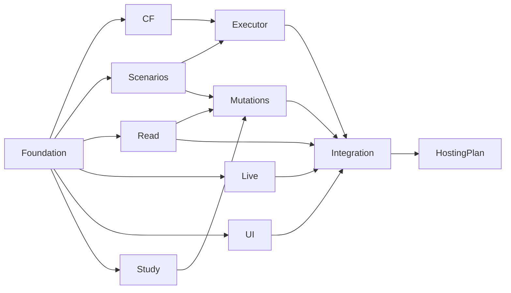

# Playground foundation

The published `effect-jobs@0.1.0-alpha.1` library stays at repository root.
`src/`, library tests and normative `specs/` are unchanged. The applications and
shared package are private consumers, not new library features. This foundation
contains declarations, fixtures and composition anchors, not a running website,
Durable Object, database adapter or deployment. Imports start no services.

## Stack and exact pins

Use vanilla TypeScript, semantic HTML and ordinary CSS for the website; Bun's
bundler builds browser assets. This is the chosen minimal frontend stack; no
React, full-stack framework, CSS framework, Nx or Turborepo is required. Docs
content lives in `apps/website/content/docs/`; its static rendering/navigation
belongs to the UI slice. Normative specs remain in `specs/`. Server transport is
Fetch Request/Response at the app boundary, with Effect services underneath.
The Cloudflare slice must qualify the actual worker/runtime boundary before a
hosting target or SDK is added. No Node deployment fallback is selected.

| Dependency/tool                  | Pin                        | Boundary                                                |
| -------------------------------- | -------------------------- | ------------------------------------------------------- |
| Bun                              | 1.4.2                      | root package manager and app bundler                    |
| Node                             | 24.15.0                    | local qualification only                                |
| effect                           | 4.0.0                      | each private consumer and library peer                  |
| effect-jobs                      | current root 0.1.0-alpha.1 | local `file:../..`; immutable tarball for qualification |
| playground-contracts             | private 0.0.0              | `workspace:*` between private packages                  |
| TypeScript                       | 7.0.2                      | existing root toolchain                                 |
| @effect/tsgo                     | 0.48.0                     | existing root compiler/linter patch                     |
| @types/node                      | 26.4.1                     | existing root dev tool                                  |
| oxfmt / oxlint / oxlint-tsgolint | 0.71.0 / 1.86.0 / 7.0.2003 | existing root tools                                     |
| Vitest                           | 4.1.11                     | existing root test runner                               |
| drizzle-orm                      | 1.0.0-rc.5-169397b         | existing optional library peer/dev dependency only      |

No database client, CF SDK, provider or web dependency is added to published
library dependencies. Requested new pins go through the serial foundation owner.

## Root/workspace setup and gates

Bun documents package workspaces and local sibling `workspace:*` dependencies:
[official workspace documentation](https://bun.sh/docs/pm/workspaces).
Actual probes against pinned Bun 1.4.2 show that the root package is not a child
workspace: consumer `effect-jobs: workspace:*` fails with “Workspace dependency
not found”. A filesystem `link:../..` is not Bun's named global linking protocol
and also fails. We use `file:../..`, which Bun materializes as a local copy under
its isolated linker, and true `workspace:*` for the private child package.
Building after installing that root copy does not update it. Refresh the copy
after library build; the qualification guard compares every exported JS file.
No TypeScript alias redirects `effect-jobs` to source.

From a new isolated checkout, use these ordered steps (no secrets needed):

```sh
bun install --frozen-lockfile --ignore-scripts
bun run build
bun install --frozen-lockfile --ignore-scripts --force
bun run playground:build
bun run playground:check
bun run playground:lint
bun run playground:test
bun run format:check
(cd tests/postgresql && bun install --frozen-lockfile --ignore-scripts)
(cd tests/qualification/d6-pg && bun install --frozen-lockfile --ignore-scripts)
bun run verify
bun run playground:qualify
```

The force install refreshes only this checkout's local dependency copies; it
also replaces patched tool binaries, so subsequent `toolchain:setup` is required
and is already called by `check`/`verify`. Workspace build compiles private
contracts and bundles both inert app entrypoints. Contracts export source types
and built JS intentionally: development typechecking sees current declarations,
runtime users must build contracts first. The package is private, never published.
The packed qualification copies the actual contracts into an independent npm
consumer, uses only the packed library and exact Effect/TS pins, checks strict
Typescript declarations with `skipLibCheck:false`, runs actual codec roundtrips
and mock reads on Node/Bun, and builds the DTO/definition browser graph. It
requires registry access; does not touch PG or existing configuration/secrets.

Every subprocess in the packed runner has a 10-minute timeout. Each invocation
creates a new immutable archive and logs/receipt under `.toolchain/playground/`.
The consumer is task-owned temporary storage outside the repository ancestry,
so Node/Bun cannot fall back to root dependencies or optional peers.
The archive inventory excludes apps, private packages, dependencies and harness
files; packed library `dist` bytes must equal current root build bytes. No
workspace alias or copied source library is available to its consumer. Existing
library installed/backend/docs gates remain separate requirements before any
future authorized push. Foundation results do not claim those external backend
gates passed, or that upstream strict Drizzle declarations are repaired.

## Frozen contract modules

Import focused private subpaths, not a barrel or a default adapter:

| Subpath       | Contract                                                                                  |
| ------------- | ----------------------------------------------------------------------------------------- |
| `Sandbox`     | branded sandbox identity, generation, expiry, capabilities and finite limits              |
| `Jobs`        | filters, opaque cursor, list/detail DTOs and synthetic app relations                      |
| `Scenarios`   | bounded scenario commands, exact-request receipt lookup, commit/unknown results and reset |
| `Changes`     | optional notification hints and mandatory read reconciliation                             |
| `Services`    | Context tags for authority, reads, commands and changes; bounded public errors            |
| `Definitions` | one versioned generic scenario job and shared producer declaration                        |
| `Fixtures`    | strictly decoded synthetic list/detail/sandbox examples                                   |
| `MockLayer`   | composable read/filter/detail and poll-only change adapters; mutations unavailable        |

Schemas are the transport boundary: decode unknown input/output with
`onExcessProperty: "error"`, including nested objects. Never export raw Schema
errors containing input. Public failure responses are only `{ code }` through
`toPublicError`; provider errors, stacks, SQL, raw Cause and secrets stay out of
responses and telemetry. Unexpected defects need a fresh bounded unavailable
response at the HTTP boundary without collapsing internal Cause/interruption
semantics or inferring rollback. Scenario results distinguish acknowledged
`Committed` enqueue from `OutcomeUnknown`; neither claims handler success.

The list is a metadata allowlist. It never reads/decrypts payloads or exports
ciphertext, fingerprints, lease tokens, schema diagnostic input or credential
material. Detail is also metadata-only; application relations are synthetic
allowlisted values, not arbitrary payload previews. `updatedAt`, `availableAt`,
`completedAt`, attempts, stalled count and lifecycle version exist in the actual
library schema. `completedAt` is populated only for Completed/Dead. There is no
invented created timestamp, progress percentage, attempt history, or execution
started timestamp. Optional `observation` has an explicit source and observation
time; its absence means unknown, not zero progress or success. Handler attempts
are finalized-attempt numbers and may repeat after unknown recovery.

Library-assigned `JobId` identifies a consequence, not an application user,
tenant, order or sandbox. Producer `(operation, operationId, slot)` identifies
deduplication in storage. Server-generated operation IDs must namespace sandbox
and generation and retain stable request identity across business retries;
clients must not choose another sandbox's producer identity. Application-owned
relations map sandbox/generation/request/order to jobs and receipts in the SAME
producer transaction. Filters apply to those authorized joins, never to an
unchecked global jobs table. No storage-specific query code enters UI/live.

## Read and notification semantics

List defaults at the transport boundary to limit 25, maximum 50; filters are
exact state/kind matches. Ordering is stable ascending library-assigned job ID
under an exact deterministic collation. Cursor is opaque, bounded to 1024 chars,
server-authenticated and bound to sandbox, generation, filters and last job ID;
clients must restart when filters or generation change. Tamper/mismatch produces
invalid-request, never cross-sandbox reads. Keyset pages are current reads, not
an immutable historical snapshot: state-filter changes can move rows between
pages, so reconciliation replaces the active list. A cursor carries no payload,
secret or provider content. Expiry is checked on every read, detail and change
subscription. Missing/foreign jobs both produce not-found.

`Changes.read` supports poll-only mode without PG CDC, Electric or LiveStore.
Notifications are hints, at most 50 per batch, with scoped cursors and job IDs;
never authoritative state or arbitrary provider events. Reconnect, cursor gap,
unknown cursor, reset and periodic 5-second reconciliation cause a fresh read.
Deduplicate hints; reject an older generation; replace current data after reset.
Loss/coalescing of hints must not prevent convergence. A WebSocket adapter owns
its scoped lifetime, bounded buffers, heartbeat and reconnect policy. Revalidate
expiry/generation during its lifetime. Polling remains available if notifications
are absent; no notification delivery/exactly-once guarantee is frozen here.

## Sandbox authority, reset and limits

Anonymous access is a per-browser sandbox capability, not public access to all
jobs. The future authority adapter creates a cryptographically random credential,
stores only its verifier in app-owned storage and delivers it in a Secure,
HttpOnly, SameSite=Strict, Path=/ `__Host-` cookie on the website origin. Never
place it in URLs, localStorage, DTOs, logs, notifications or source fixtures.
No existing secrets are read/copied. The server authenticates on every request;
`SandboxAccess` is server-owned context, never decoded from the request body.
A request's sandbox reference only asserts expected identity/generation; it is
not authority. Worker access uses a separately qualified internal service
binding, never anonymous credentials forwarded to an arbitrary origin.
Mutation requests also enforce origin/CSRF protection, request/content bounds,
per-sandbox admission and rate limits; capability booleans are UI hints and the
server recomputes authority. No production auth integration is implied.

Default finite budgets: one-hour sandbox lifetime, 100 retained jobs per sandbox,
10 jobs per scenario request, list maximum 50, 5-second read reconciliation.
Admission and job/receipt writes must enforce quotas atomically to avoid races.
The authority expiry check uses DB time; equality (`expiresAt <= dbNow`) denies
access. The mock clock tests only that mock boundary, not DB-time enforcement.
Infra/request rate/billing budgets remain owner-approved deployment prerequisites;
no free-tier assumption grants provisioning authority.

Reset transactionally increments generation and stores the exact request's
receipt. Generation overflow refuses reset instead of wrapping or reusing a generation.
The compare-and-swap expects the old generation, so competing reset or
stale commands fail stale-generation. `Committed` returns previous/current refs;
unknown commit must be resolved by exact-request read-only receipt lookup.
Receipt absence does not authorize replay. Expiry/reset revokes admission and
visibility for the old generation, not library ownership fencing. Old workers
must check generation/expiry before each synthetic provider/app result write and
guard that write in the same app transaction. Late observations, notifications
and app results must not enter the new generation. Jobs retain their library
lease/finalization protocol; reset is not cancellation and never directly UPDATEs
lifecycle state. Active/Pending/Isolated rows are not reset cleanup candidates.
App-owned retention coordinates terminal cleanup with mapping/receipt references.

`retryJob`, `cancelJob` and `redriveJob` stay false until the capability study
proves supported lifecycle operations. Mock `runScenario`/`resetSandbox` are also
false: mocks return capability-unavailable, not fake durable success. No live
email, payment or arbitrary outbound webhook is permitted; all provider data and
effects are synthetic. Issuance/storage/CSRF/quotas/reset/fencing are obligations
for downstream implementations, not functionality implemented by these tags.

## Exclusive paths and dependency DAG

The coordinator assigns isolated authors only after they consume this frozen
foundation. All manifests, lockfiles, root/app configs, private shared contracts,
route/service/handler registrars, migration registry and deployment configuration
have one serial owner. Other authors request additions rather than edit them.
Foundation does not dispatch or review downstream work.

| Issue/slice                   | Exclusive downstream paths                                                                                                                                                                                                                                                                                            | Required inputs                                           |
| ----------------------------- | --------------------------------------------------------------------------------------------------------------------------------------------------------------------------------------------------------------------------------------------------------------------------------------------------------------------- | --------------------------------------------------------- |
| UPVE-1863 foundation          | `packages/playground-contracts/**`, root manifest/lock/playground config, app manifests/configs, `apps/website/src/Client.ts`, `apps/website/src/server/{Routes,Services}.ts`, `apps/playground-worker/src/{Worker,HandlerRegistry}.ts`, `apps/playground-worker/src/persistence/MigrationRegistry.ts`, this document | owner baseline                                            |
| UPVE-1864 CF PoC              | `apps/playground-worker/src/cloudflare/**`, `apps/playground-worker/tests/cloudflare/**`                                                                                                                                                                                                                              | contracts; actual resources only if authorized            |
| UPVE-1865 scenarios/providers | `apps/playground-worker/src/scenarios/**`, `apps/playground-worker/src/providers/**`, `apps/playground-worker/tests/scenarios/**`                                                                                                                                                                                     | definitions; request shared schema changes                |
| UPVE-1866 read API            | `apps/website/src/server/read/**`, `apps/website/tests/read/**`, `apps/playground-worker/src/persistence/read/**`                                                                                                                                                                                                     | DTOs, authorized PG mapping                               |
| UPVE-1867 live                | `apps/website/src/live/**`, `apps/website/src/server/live/**`, `apps/website/tests/live/**`, `apps/playground-worker/src/live/**`                                                                                                                                                                                     | change/read contracts; mocks permitted                    |
| UPVE-1868 UI/docs             | `apps/website/src/features/jobs/**`, `apps/website/src/styles/**`, `apps/website/content/docs/**`, `apps/website/tests/ui/**`                                                                                                                                                                                         | DTOs/capability flags; mocks permitted                    |
| UPVE-1869 capability study    | `docs/playground-capabilities.md`, `apps/playground-worker/tests/capabilities/**`                                                                                                                                                                                                                                     | actual current library API, read-only evidence            |
| UPVE-1870 executor            | `apps/playground-worker/src/execution/**`, `apps/playground-worker/tests/execution/**`, `apps/playground-worker/src/persistence/authority/**`                                                                                                                                                                         | CF PoC + scenarios                                        |
| UPVE-1871 mutations           | `apps/website/src/server/commands/**`, `apps/website/tests/commands/**`, `apps/playground-worker/src/persistence/commands/**`                                                                                                                                                                                         | capability study + read API + scenarios                   |
| UPVE-1872 qualification       | `apps/website/tests/integration/**`, `apps/playground-worker/tests/integration/**`, `docs/playground-findings.md`                                                                                                                                                                                                     | ready slices, serial integration                          |
| UPVE-1873 hosting preparation | `docs/playground-hosting.md`, proposed descriptors under `apps/playground-worker/infra/deploy/**`                                                                                                                                                                                                                     | qualified integration; serial owner applies actual config |
| UPVE-1874 SQLite study        | no current implementation paths                                                                                                                                                                                                                                                                                       | deferred, do not activate                                 |



Ready contracts do not authorize dispatch, review, push or deployment; the
coordinator controls activation/readiness and one frozen review round. Registrar
and migration additions are integrated serially. Deployment config remains
serial even when the hosting author prepares a proposal.

## Remaining gates and decisions

The chosen layout and frontend scope need no repeated confirmation. CF/PG
feasibility, driver/runtime pins, actual PostgreSQL mapping/indexes, credential
custody, quotas/rate limits, deployment domain/resources/SKU/billing and cloud
permissions remain downstream qualification/owner gates. Storage, issuance,
reset and operator APIs are absent; no implementation is enabled by a capability
flag. No existing database/container, hosted/workerd runtime, network-crash
behavior, complete UI, WebSocket or operator action is qualified by fixture
success. Any required source-library runtime fix needs a separate approved task.
